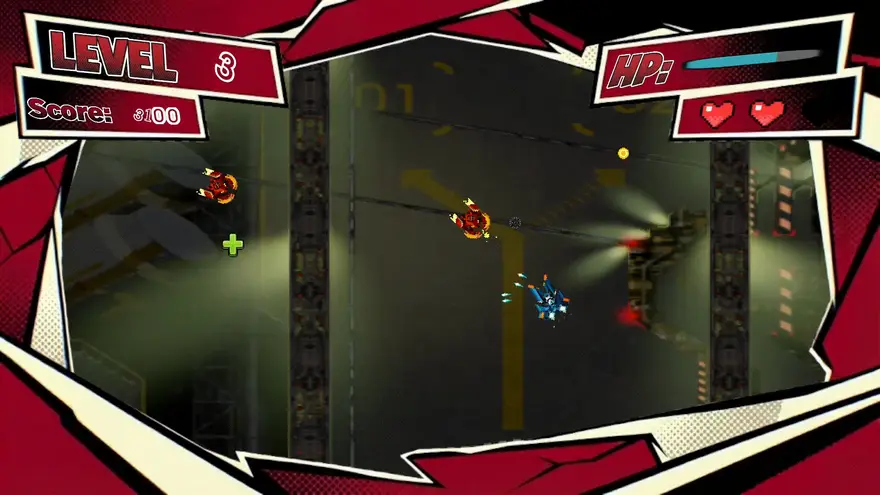
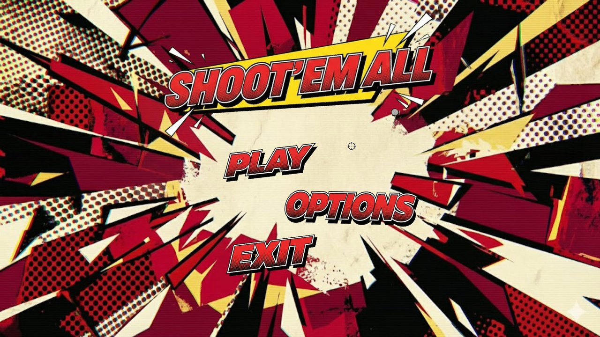
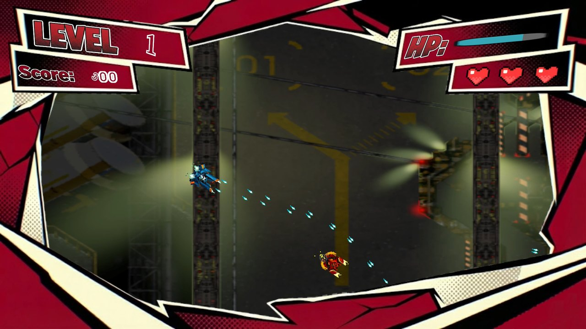

<div align="center">

# 🚀 Shoot'em All

**Shoot 'em up 2D de estética cómic en el que pilotas una nave, apuntas con el ratón y sobrevives a oleadas de enemigos cada vez más numerosas**

[]()
[]()
[]()

</div>

---

## 📖 Sobre el proyecto

Un *space shooter* clásico de pantalla fija: tu nave se mueve con el teclado, **dispara hacia donde apunta el ratón** y los enemigos se desplazan por la pantalla disparándote. Cada nivel trae más enemigos que el anterior, y la puntuación te da de vez en cuando una cura. Incluye menú principal, opciones, pantalla de carga y pantalla de fin de partida.

> 📌 **Proyecto académico** del *Máster en Diseño y Desarrollo de Videojuegos* de la **UNIR**, hecho con Unity 6. El curso también incluyó un shooter distinto hecho con Unreal Engine: [UnaiGB_SpaceShooter](https://github.com/unaigb/UnaiGB_SpaceShooter).

---

## 🖼️ Capturas

<p align="center">
  
</p>

<p align="center">
  
  
  
</p>

<p align="center"><em>Menú principal y dos momentos de una partida, con el nivel y la puntuación a la izquierda, y la vida a la derecha.</em></p>

---

## 🎮 Cómo se juega

- **Muévete** por la pantalla y **mantén pulsado el disparo**: la nave dispara a ráfagas muy rápidas hacia el cursor.
- Tienes **3 vidas** y **100 puntos de salud**. Al recibir un golpe, la nave es invulnerable unos instantes.
- **Los enemigos** se mueven hacia puntos aleatorios de la pantalla, te miran en todo momento y disparan cuando están a la vista.
- **Cada nivel** genera más enemigos: empieza con 10 y suma 5 más en cada nivel, con una pantalla de subida de nivel entre medias.
- **Cada 500 puntos** aparece un objeto de cura.
- Si pierdes todas las vidas, la pantalla de fin de partida muestra tu puntuación y te devuelve al inicio.

### 🕹️ Controles

| Acción | Teclado y ratón | Mando |
| :--- | :---: | :---: |
| Moverse | `W` `A` `S` `D` | Stick izquierdo |
| Disparar (mantener) | Clic izquierdo | `A` |
| Apuntar | Ratón | — |

---

## ✨ Qué incluye

- **Disparo dirigido al cursor**, con cadencia alta y balas que desaparecen al salir de la pantalla.
- **Oleadas por niveles** con dificultad creciente y zona de juego delimitada.
- **HUD** con puntuación, vidas, salud y nivel.
- **Animaciones y sonidos** para la nave, los enemigos y los disparos.
- **Menú principal, opciones, pantalla de carga y pantalla de fin de partida.**

---

## 🚀 Cómo ejecutarlo

**Requisitos:** [Unity Hub](https://unity.com/download) y el editor **Unity 6000.2.7f2**.

1. En Unity Hub, *Add → Add project from disk* y elige la raíz de este repositorio.
2. Abre el proyecto con el editor 6000.2.7f2 (la primera vez tarda en importar los assets).
3. Abre la escena `Assets/Scenes/Menu.unity` y pulsa **Play**.

No hay una versión compilada publicada.

---

## 🔧 Detalles técnicos

- **Modelo separado del comportamiento:** `PlayerModel` y `EnemyModel` guardan los datos (vidas, salud, puntuación, velocidad) y `PlayerSpaceShip` y `EnemyBehaviour` se ocupan de la lógica en escena.
- **`Manager` como director de la partida:** calcula la zona de juego a partir de un `EdgeCollider2D`, genera enemigos sin que aparezcan encima de la nave (radio de seguridad) y controla el nivel, la cura y el fin de partida.
- **Entrada con acciones** del nuevo Input System, sin leer teclas directamente.

---

## 📂 Estructura del repositorio

```
2025_SpaceShooter_UnaiGB/
├── Assets/
│   ├── Scenes/            # Menu y Game
│   ├── Scripts/
│   │   ├── Player/        # Nave, disparo y modelo
│   │   ├── Enemies/       # Comportamiento, disparo y modelo
│   │   ├── Menus/         # Menú, opciones y pantalla de carga
│   │   └── Manager.cs · UIController.cs · EndGame.cs
│   ├── Animations/ · Prefabs/ · Sprites/ · Sounds/ · Fonts/
│   └── InputActions/
├── Media/                 # Capturas y animación del juego
├── Packages/
└── ProjectSettings/
```

---

## 🖥️ Stack tecnológico

| Categoría | Herramientas |
| :--- | :--- |
| **Motor** | Unity 6 (6000.2.7f2) con Universal Render Pipeline 2D |
| **Lenguaje** | C# |
| **Paquetes** | Input System · TextMesh Pro |

---

## 🎨 Créditos de terceros

Este repositorio puede incluir sprites, sonidos y tipografías de otros autores, que conservan sus propias licencias.

---

## 👤 Autoría

**Unai García** — Máster en Diseño y Desarrollo de Videojuegos (UNIR)

- 🐙 GitHub: [@unaigb](https://github.com/unaigb)
